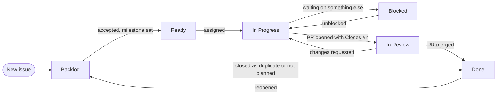

# Contributing

## Build and check

The toolchain is pinned in `rust-toolchain.toml`; the minimum supported Rust is 1.95. Before a
PR, run what CI runs. `--locked` makes a command fail instead of quietly rewriting `Cargo.lock`,
as in CI; a dependency change updates the lock file on purpose and commits it.

```sh
cargo fmt --all --check
cargo clippy --workspace --all-targets --locked -- -D warnings
cargo clippy --workspace --all-targets --all-features --locked -- -D warnings
(set -e; for f in "" nats iggy postgres; do cargo check -p sisa-eventing --features "$f" --locked; done)
RUSTDOCFLAGS="-D warnings" cargo doc --workspace --no-deps --all-features --locked
cargo +1.95 check --workspace --all-targets --all-features --locked
cargo test --workspace --all-features --locked
cargo deny check
cargo semver-checks --workspace --all-features --baseline-rev origin/main   # unless labeled `breaking`
lychee --offline --include-fragments --hidden --exclude-path '(^|/)(\.git|\.claude|target)/' './**/*.md'
```

A weekly workflow also checks the workspace with every direct dependency at its lowest allowed
version: `cargo +nightly update -Z direct-minimal-versions`, then `cargo check --workspace
--all-targets --all-features`. Restore `Cargo.lock` afterwards.

## Tests

Unit tests sit at the end of the file they test, in `#[cfg(test)] mod tests`. Tests that put
several parts together, such as a bus with its dispatcher, or anything on NATS, PostgreSQL or Iggy, go in
a file in the crate's `tests/it/` folder, which builds as one test binary, so the files run side by
side. A test that installs something process-wide, such as a meter provider, gets a binary of its
own. Each NATS, PostgreSQL or Iggy test starts its own server in Docker through
`sisa-eventing-testing`, so the suite needs Docker and nothing else. `NATS_IMAGE` picks the NATS
server, `nats:2.15-alpine` by default, `POSTGRES_IMAGE` the database, `postgres:18-alpine` by
default, and `IGGY_IMAGE` the Iggy server, `apache/iggy:0.10.0` by default. CI tests these newest
releases only. The Iggy server runs on io_uring, so its container gets the `SYS_NICE` capability
and no seccomp profile; a Docker that refuses those can't run the Iggy tests.

```sh
NATS_IMAGE=nats:2.15-alpine POSTGRES_IMAGE=postgres:18-alpine IGGY_IMAGE=apache/iggy:0.10.0 \
  cargo test --workspace --all-features
```

Docker Hub limits anonymous pulls. When a pull fails with `429 Too Many Requests`, run
`docker login`, or pull the image from Google's mirror under the name the tests use:

```sh
docker pull mirror.gcr.io/library/nats:2.15-alpine
docker tag mirror.gcr.io/library/nats:2.15-alpine nats:2.15-alpine
```

Coverage comes from [cargo-llvm-cov](https://github.com/taiki-e/cargo-llvm-cov); CI measures it on
each push to main.

```sh
cargo llvm-cov --workspace --all-features --ignore-filename-regex 'crates/testing/'
```

Write tests a reader can follow: one behavior per test, named for that behavior, as few lines as
it takes. Wait for another task with `eventually` instead of sleeping, and use paused Tokio time
for timers.

## Code

- Keep code minimal, readable, and working. Judge every change by that.
- Read [docs/01-architecture.md](docs/01-architecture.md) first; its rules section lists what
  reviews check.
- API docs live in Rust doc comments: short, plain, with an example where it helps. Don't link
  Markdown files from crate docs.
- The pages in `docs/` explain how the library works. Draw diagrams in Mermaid, and update the
  page a change affects in the same PR, above all the data formats in the architecture page.
- Public names are reviewed with care; rename a parameter, its getter and its field together.

### What the public API is

A change to any of these is breaking: it takes `!` in the commit and the `breaking` label.

- Every public Rust item that isn't `#[doc(hidden)]`. Hidden items aren't part of the supported
  API: Rust has no visibility between crates, so they are `pub` for the other crates of this
  workspace and their tests, and any crate can still reach them, but a release may change them.
- The settings' field names, which config files use, and what each default is.
- The metric names and attributes, and the span names and fields, once they are documented.
- The [data formats](docs/01-architecture.md#data-formats): the envelope's headers, the subject,
  stream and consumer names, and the outbox and inbox tables, which other languages and the
  application's own migrations depend on.
- The async-nats and sqlx types that reach the API: moving to a release of theirs that breaks
  their own API is breaking here too.

The settings structs and the error enums are `#[non_exhaustive]`, so a new setting or variant isn't
breaking. Build settings from `default()` and set fields on it.

## Code style

`rustfmt.toml`, `clippy.toml` and the workspace's `[workspace.lints]` settle layout and lints, and
CI fails on any of them. A new package takes those lints with `[lints] workspace = true`. What
they don't check:

- Imports come in groups separated by a blank line: `std`, other crates, then `crate` and
  `super`.
- Doc comments and comments are full sentences, wrapped at 100 columns like the code. A comment
  says why, or what a reader can't see from the code; it doesn't repeat the code.
- Names are whole words (`envelope`, `delivery`), and the message type parameter is `Msg`
  everywhere. Clippy's `min_ident_chars` catches single letters, `i` and `n` included.
- A name means one thing in its scope. A new binding may reuse a name for the same value
  converted (`let prefix = prefix.into()`); anything else gets a name of its own, such as
  `handle_and_ack` for the closure that wraps `handle`. Clippy's `shadow_unrelated` catches the plain
  cases.
- Library code returns errors instead of panicking: no `unwrap` outside tests, and `expect` only
  for an invariant, with a message saying why it holds. Poisoned locks are recovered with
  `into_inner`.
- A blank line separates steps in a long function; short functions need none.
- A file defines each item before the code that uses it: helpers first, then the type built from
  them, with its struct and impls together. The test module comes last.
- Each trait impl has a one-line `//` comment above it saying what it gives the caller or why it
  exists.
- Write a closure that returns a future as an async closure, `async || ...` or
  `async move || ...`, not `|| async { ... }`. Keep an `async move` block only where Rust needs
  one: the body of a public trait method that returns `impl Future + Send`, since an `async fn`
  there can't promise `Send`, and a future handed to a function such as `tokio::spawn`,
  `timeout` or `Box::pin`.
- Every public type implements `Debug`, which `missing_debug_implementations` checks. A bus, a
  transport or a persistence shows its name and settings, never a message body, a connection or a
  password in a URL.

## Issues and labels

Every issue has a type: Bug, Feature or Task. The issue forms set it; set it yourself on an issue
opened another way. Docs work is a Task. Pull requests have no type; their linked issue has it.

Every issue and pull request also gets labels from these groups, so anyone can filter the work:

| Group | Labels | Rule |
| --- | --- | --- |
| Crate | `crate: sisa-eventing`, `crate: core`, `crate: runtime`, `crate: nats`, `crate: iggy`, `crate: postgres`, `crate: testing`, `ci` | Every part the change touches. |
| Other | `documentation`, `needs info`, `breaking`, `good first issue`, `help wanted` | When they apply. |
| Automated | `dependencies`, `release` | Set by Dependabot and release-plz on their PRs. |

- `documentation`: docs only, such as doc comments, `docs/` or the README.
- `needs info`: the reporter owes details or a reproduction. Remove it once they answer.
- `breaking`: the public API or a data format changes. The PR says how to migrate. CI's `semver`
  job fails a PR that breaks a published crate's API, against the PR's base, without it; re-run
  the job after adding it.
- Close a duplicate as "duplicate" with a link, and a declined request as "not planned" with the
  reason. Answer a question in its issue, then close it.

Work moves across the `sisa-eventing` project board:



Only the maintainer moves an issue to Ready and sets its milestone and Priority (P0 urgent to P3
low); work the maintainer asks for directly gets the next release's milestone when its issue is
opened. Assign yourself before starting so two people don't take the same issue; the maintainer
moves it to In Progress. The board's workflows do the rest: a new issue lands in Backlog, a PR
with `Closes #n` moves it to In Review, and closing or merging moves it to Done. A Blocked issue
says in a comment what it waits on. Start date and Target date place an issue on the Roadmap
view.

A milestone is a release, and its due date is the target. Every issue that ends in a merged PR
needs one before the PR merges, so the milestone shows what the release ships. Releases are cut
by hand, so a merged issue can be Done before it ships: while its milestone is open, its release
isn't out yet. The maintainer closes a milestone once its release is published.

The labels, milestones, board and the rulesets on `main` and the `v*` tags are kept in
[.github/scripts](.github/scripts/README.md). Change them there in a PR, and a maintainer runs the
script after the merge. A run overwrites what it manages, so a change made only on GitHub doesn't
last.

## Git

- Every PR closes an issue: open one first if none exists, and say `Closes #n` in the PR. Only
  Dependabot's and release-plz's PRs come without one.
- A PR's assignee is its author, and it carries the crate labels of its issue. The type,
  milestone and Priority stay on the issue.
- Branch from `main` as `<type>/<issue>-<topic>`, one topic per PR. `<type>` is the
  [commit type](#commit-messages) of the change and `<issue>` the number of the issue it closes,
  such as `feat/31-outbox-dispatcher`, `fix/42-nats-reconnect` or `ci/17-tag-ruleset`. Dependabot's and
  release-plz's branches keep their own names.
- Bring a branch up to date by rebasing onto `main`; don't merge `main` into it.
- PRs merge with the rebase method once CI is green.
- Commit messages and PR titles follow [Commit messages](#commit-messages).

### Commit messages

We use [Conventional Commits](https://www.conventionalcommits.org/en/v1.0.0/). release-plz reads
the type to pick the changelog section and the version bump.

```text
fix(postgres): release a claimed outbox row when its publish fails

What was wrong and why this fixes it, wrapped at 72 columns.
```

- The subject is `type(scope): summary`, at most 72 characters, with no period at the end.
  Write the summary in the imperative: "add", "fix", "keep".
- The scope is optional. Use it when the change sits in one crate: `core`, `runtime`, `nats`, `iggy`, `postgres`,
  `testing` or `facade`, or `deps` for a dependency bump.
- Add `!` after the type or scope for a breaking change (`feat(core)!: ...`), and say how to
  migrate in the body.
- The body says what changed and why. Put `[skip ci]` there, never in the subject.
- A PR title follows the same rule, since it names the change on the board.

| Type | For | Changelog |
| --- | --- | --- |
| `feat` | a new capability for users | Added |
| `fix` | a bug fix | Fixed |
| `perf` | a speed or memory improvement | Changed |
| `refactor` | a code change users don't see | left out |
| `docs` | docs and doc comments only | left out |
| `test` | tests only | left out |
| `build` | dependencies, Cargo files | left out |
| `ci` | workflows | left out |
| `chore` | anything else, such as releases | left out |
| `revert` | undoing an earlier commit | Fixed |

A hook checks each commit as you make it. Turn it on once per clone:

```sh
git config core.hooksPath .githooks
```

CI runs the same check on a PR's commits and title.
