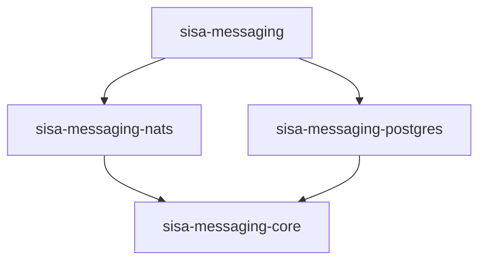

# Architecture

A map of the design for contributors. What each type does for users will be in its Rust docs; this
page explains how the parts fit, what they promise, and which rules hold them together.
[Flows](02-flows.md) draws each step described here, and [Research](03-research.md) says where the
ideas come from.

> [!NOTE]
> This page is the design for the first milestone, written before the code. Names in it are
> proposals until the maintainer settles them; the [Decisions](#decisions) table says which
> choices are settled.

## Goals

- **Pick the parts at startup.** A transport (NATS first, then the Kafka family, RabbitMQ and
  LavinMQ, Iggy), a persistence (PostgreSQL first, then MySQL and SQL Server) and a codec (JSON
  first, then MessagePack and Avro). Handlers and publishing code don't change when a part does.
- **The outbox and the inbox are optional.** An application can use plain messaging, add an
  outbox so a message is published if and only if its database transaction commits, and add an
  inbox so a redelivered message is skipped instead of handled twice.
- **At least once, everywhere.** No mode loses a message the broker or the database accepted.
  With the inbox, a handler's database work happens once per endpoint and message.
- **A shared, documented wire format.** Services in other languages publish and consume the same
  messages: the envelope follows CloudEvents 1.0 in each transport's binary mode.
- **Small and explicit.** Building a bus is all the setup; it runs its own workers. Each part has
  one way in and one way out.

## Words used everywhere

| Word | Meaning |
| --- | --- |
| **Message** | A Rust type that implements `Message`: serde for the body, and a `NAME` such as `orders.order_placed.v1` |
| **Message name** | Levels of `[a-z0-9_]` joined by `.`, ending with the version of the message's shape. It is valid as a NATS subject, a Kafka topic and an AMQP routing key |
| **Envelope** | A message on its way: its id, name, content type, correlation and causation ids, time, headers, and the encoded body |
| **Codec** | Turns a message into bytes and back, and names the content type, such as `application/json` |
| **Transport** | Moves envelopes: publishes them to the broker and delivers them to endpoints |
| **Endpoint** | A named, durable subscription, such as `billing`. Every instance of a service shares its endpoint (competing consumers), and each endpoint gets its own copy of every message it subscribes to (fan-out) |
| **Handler** | Application code that handles one message type on one endpoint |
| **Bus** | What the application holds: it publishes, and it runs the endpoints and their handlers |
| **Outbox** | The `outbox_messages` table in the application's database. A publish inside a transaction writes a row there, and the **dispatcher** publishes the row after the commit and marks it dispatched |
| **Inbox** | The `inbox_receipts` table: a receipt per `(endpoint, message id)` handled, written in the handler's transaction, so a redelivery is acknowledged without running the handler again |
| **Partition** | One time range of a table, a day by default. Both tables are partitioned, so old data leaves by whole partitions, never by `DELETE` |
| **Retention** | How long a partition is kept before it is detached (kept as a table of its own, for archiving) or dropped. Off by default: outbox and inbox rows are business data |

## Crates



| Crate | Published | Main types | What it holds |
| --- | --- | --- | --- |
| `sisa-messaging` | Yes | Everything below that an application uses | Re-exports only; features `nats` and `postgres` pick the parts, none by default |
| `sisa-messaging-core` | Yes | `Message`, `Envelope`, `MessageId`, `Codec`, `JsonCodec`, `Transport`, `Delivery`, `Outbox`, `Inbox`, `Bus`, `Handler` | The contracts every part implements, the JSON codec, the bus with its receive pipeline and retry policy, and an in-memory transport for tests |
| `sisa-messaging-nats` | Yes | `NatsTransport`, `NatsSettings` | JetStream: a stream per bus, a durable pull consumer per endpoint |
| `sisa-messaging-postgres` | Yes | `PostgresOutbox`, `PostgresInbox`, `PostgresSettings` | The tables and their migration, writes in the caller's transaction, the dispatcher's claims, and the worker that creates partitions ahead and applies the retention |
| `sisa-messaging-testing` | No | `Nats`, `Postgres`, `eventually` | A NATS and a PostgreSQL container per test, and a wait-until helper |

Later crates follow the same shape: `-kafka` (Kafka, Redpanda, WarpStream), `-amqp` (RabbitMQ,
LavinMQ), `-iggy`, `-mysql`, `-mssql`, `-msgpack`, `-avro`. JSON stays in core: serde is a bound
on every message anyway, and the first milestone needs no other codec.

## The contracts

Sketches, to show where each responsibility sits. The code settles the exact signatures.

### Message and envelope

```rust,ignore
pub trait Message: Serialize + DeserializeOwned + Send + Sync + 'static {
    /// Such as `orders.order_placed.v1`.
    const NAME: &'static str;
}

pub struct Envelope {
    pub id: MessageId,                 // UUID version 7, so ids sort by creation time
    pub name: MessageName,             // the `Message::NAME`
    pub source: String,                // the publishing service, such as `orders`
    pub time: Timestamp,
    pub content_type: String,          // from the codec
    pub correlation_id: Option<MessageId>,
    pub causation_id: Option<MessageId>, // the message being handled when this one was published
    pub headers: Headers,              // anything else, `traceparent` included
    pub body: Bytes,
}
```

### Codec

```rust,ignore
pub trait Codec: Send + Sync + 'static {
    fn content_type(&self) -> &'static str;
    fn encode<Msg: Message>(&self, message: &Msg) -> Result<Bytes, CodecError>;
    fn decode<Msg: Message>(&self, body: &[u8]) -> Result<Msg, CodecError>;
}
```

A bus has one codec for what it publishes. A receiver picks the codec by the envelope's content
type, so a service can move to another codec while old messages drain.

### Transport

```rust,ignore
pub trait Transport: Send + Sync + 'static {
    /// Returns once the broker has the envelope: a JetStream publish acknowledgement, a Kafka
    /// produce acknowledgement, a RabbitMQ publisher confirm.
    async fn publish(&self, envelope: &Envelope) -> Result<(), TransportError>;

    /// Creates the endpoint's durable subscription if needed, and streams its deliveries.
    async fn receive(&self, endpoint: &EndpointSpec) -> Result<Deliveries, TransportError>;
}

pub trait Delivery: Send {
    fn envelope(&self) -> &Envelope;
    fn attempt(&self) -> u32;                 // 1 on the first delivery
    async fn ack(self) -> Result<(), TransportError>;
    async fn retry(self, delay: Duration) -> Result<(), TransportError>;
    async fn reject(self) -> Result<(), TransportError>; // no more attempts
}
```

### Outbox and inbox

The write side runs on the application's own connection or transaction, whose type depends on the
database, so each trait names it:

```rust,ignore
pub trait Outbox: Send + Sync + 'static {
    type Connection: ?Sized;                 // `sqlx::PgConnection` for PostgreSQL

    async fn enqueue(&self, connection: &mut Self::Connection, envelopes: &[Envelope]) -> Result<()>;

    // The dispatcher's side, on the outbox's own pool.
    async fn claim(&self, limit: usize, lease: Duration) -> Result<Vec<OutboxRecord>>;
    async fn complete(&self, records: &[OutboxRecord]) -> Result<()>;   // marks them dispatched
    async fn fail(&self, record: &OutboxRecord, error: &str, retry_at: Option<Timestamp>) -> Result<()>;
}

pub trait Inbox: Send + Sync + 'static {
    type Connection: ?Sized;

    /// Writes the receipt for the endpoint; false when one was written before.
    async fn receive(&self, connection: &mut Self::Connection, endpoint: &str, envelope: &Envelope) -> Result<bool>;
}
```

A persistence crate also opens the transaction a transactional endpoint runs its handler in, and
runs the maintenance worker that creates partitions ahead and applies the retention.

### Bus and handlers

```rust,ignore
let bus = Bus::builder("orders", NatsTransport::connect(nats_url, settings).await?)
    .outbox(PostgresOutbox::new(pool.clone(), &pg_settings).await?) // optional
    .endpoint("billing", |endpoint| {
        endpoint.inbox(PostgresInbox::new(pool.clone(), &pg_settings)) // optional
            .handle::<OrderPlaced>(charge_order)
    })
    .start()
    .await?;

// Plain: straight to the broker.
bus.publish(&OrderPlaced { id }).await?;

// With the outbox: a row in the application's transaction, published after the commit.
let mut tx = pool.begin().await?;
sqlx::query("insert into orders ...").execute(&mut *tx).await?;
bus.publish_in(&mut *tx, &OrderPlaced { id }).await?;
tx.commit().await?;
```

A handler gets the message and a context. The context publishes with the handled message as the
causation and its correlation id carried over, and, on a transactional endpoint, hands out the
transaction.

## How each mode behaves

| Mode | A publish from application code | A publish from a handler | A redelivered message |
| --- | --- | --- | --- |
| Plain | Goes to the broker; returns when the broker has it | Held until the handler returns `Ok`, then sent before the ack | Handled again: the handler must be idempotent |
| Outbox | `publish_in(tx)` writes a row; the dispatcher publishes it after the commit. `publish` still goes straight to the broker | On a transactional endpoint, a row in the handler's transaction; otherwise as in plain mode | Handled again |
| Outbox and inbox | As above | A row in the handler's transaction | The inbox row exists, so the delivery is acked and the handler doesn't run |

The inbox needs a transactional endpoint, since its row has to commit with the handler's work. It
works without the outbox too: the handler's publishes are then sent after the commit, which leaves
a gap. A process that stops after the commit and before the send loses them, and the inbox
acks the redelivery without running the handler again. Use the outbox with the inbox when those
publishes matter.

### Receiving

For each delivery, an endpoint:

1. Decodes the body with the codec its content type names. A body that doesn't decode is rejected
   at once: no retry can fix it.
2. On a transactional endpoint, begins a transaction and, with the inbox, records the message. A
   message recorded before is committed and acked here.
3. Runs the handler.
4. On success, writes the handler's publishes to the outbox (or holds them), commits, sends any
   held publishes, then acks.
5. On an error, rolls back and asks the transport to retry after the retry policy's delay. Past
   the policy's last attempt, it publishes the envelope to the endpoint's error destination with
   the error in its headers, then rejects the delivery. If that publish fails, the delivery is
   retried after the policy's delay instead of rejected, so a message is never dropped without a
   copy in the error destination.

### Dispatching the outbox

The dispatcher is a worker the bus starts when it has an outbox. Each round it claims a batch of
due rows, publishes them in sequence order, waiting for the broker each time, and marks them
`dispatched` with the time. A row that fails is put back with a later due time and its error; past
the last attempt it is marked `failed` and left for a person to look at; setting it back to
`pending` sends it again. Claiming moves the due
time forward by a lease, so the rows of a dispatcher that dies come back once the lease runs out,
and several instances claim different rows. The envelope keeps its id in the outbox, so a row
published twice (a crash between the publish and the mark) reaches the broker with the same id:
JetStream drops it inside its duplicate window, and an inbox drops it after.

### Partitions and retention

Rows are never deleted one by one: the outbox and inbox are the application's record of what it
sent and handled. Both tables are range-partitioned by time, one partition per day by default.

- **The outbox** is partitioned by `created_at`, when the row was written.
- **The inbox** is partitioned by `message_time`, the envelope's own `time`, not by when the
  receipt was written. A redelivery carries the same envelope, so its receipt falls in the same
  partition and the primary key catches it, however many days later it comes.
- **Maintenance** is a worker the bus starts with a PostgreSQL outbox or inbox. Once an hour, with
  one instance at a time through an advisory lock, it creates the partitions for the next 7
  intervals and applies the retention. `partitions = "external"` turns it off for teams that use
  pg_partman or their own jobs.
- **Retention** is off by default. When set, such as `retention_days = 90`, a partition older than
  that is detached, which keeps it as an ordinary table for archiving, or dropped with
  `on_expiry = "drop"`. An outbox partition that still holds `pending` or `failed` rows is never
  expired; the worker warns instead. Keep the inbox retention longer than the longest redelivery, or a very
  late redelivery is handled again.
- **A default partition** catches a row whose time has no partition yet, such as a message from a
  publisher with a clock far off. The worker warns while it holds rows, since PostgreSQL can't
  create a partition over rows already sitting in the default one.

## Data formats

Services in other languages share messages and tables by following these formats. They change only
with a version bump that the changelog calls out.

### Envelope on the wire

[CloudEvents 1.0](https://github.com/cloudevents/spec/blob/main/cloudevents/spec.md) in binary
content mode: the attributes go in the transport's headers and the body is the encoded message, so
consumers that don't know CloudEvents still read a plain body.

| Attribute | Required | Value |
| --- | --- | --- |
| `specversion` | Yes | `1.0` |
| `id` | Yes | The message id, a UUID version 7 |
| `source` | Yes | The publishing service, such as `orders` |
| `type` | Yes | The message name, such as `orders.order_placed.v1` |
| `time` | Yes | When it was published, RFC 3339 |
| `datacontenttype` | Yes | The codec's content type, such as `application/json` |
| `correlationid` | No | The id that ties a conversation together |
| `causationid` | No | The id of the message whose handler published this one |
| `traceparent`, `tracestate` | No | W3C trace context, per the CloudEvents distributed tracing extension |

Each transport names the headers as its CloudEvents binding says:

| Transport | Header names | Example |
| --- | --- | --- |
| NATS | `ce-` and the attribute | `ce-id`, `ce-type`, `ce-datacontenttype` |
| Kafka family | `ce_` and the attribute | `ce_id`, `ce_type`; `content-type` for the content type |
| AMQP | `cloudEvents:` and the attribute, from the AMQP 1.0 binding, since AMQP 0-9-1 has none | `cloudEvents:id`; the content type in the `content_type` property |

On NATS the publish also sets `Nats-Msg-Id` to the message id, so JetStream drops a duplicate
publish inside the stream's duplicate window.

### NATS subjects and streams

| Thing | Name | Example |
| --- | --- | --- |
| Subject | `{prefix}.{message name}` | `sisa.orders.order_placed.v1` |
| Stream | One per prefix, capturing `{prefix}.>` | `SISA`, on `sisa.>` |
| Durable consumer | The endpoint name, filtered on the subjects of the messages it handles | `billing` |
| Error subject | `{prefix}._error.{endpoint}` | `sisa._error.billing` |

The prefix keeps deployments that share a server apart, such as `prod` and `staging`.

### PostgreSQL tables

In a schema of their own, `sisa_messaging` by default, created by `migrate`. The sequence is a
plain `bigint` with its own sequence object, since PostgreSQL before 17 has no identity columns on
partitioned tables, and a primary key there must hold the partition key.

```sql
CREATE SEQUENCE sisa_messaging.outbox_messages_sequence;

CREATE TABLE sisa_messaging.outbox_messages (
    sequence      bigint      NOT NULL DEFAULT nextval('sisa_messaging.outbox_messages_sequence'),
    created_at    timestamptz NOT NULL DEFAULT now(),
    message_id    uuid        NOT NULL,
    message_type  text        NOT NULL,              -- the message name, which picks the destination
    headers       jsonb       NOT NULL,              -- every attribute but the body
    body          bytea       NOT NULL,
    status        text        NOT NULL DEFAULT 'pending', -- pending, dispatched or failed
    available_at  timestamptz NOT NULL DEFAULT now(),     -- due time, moved forward by a claim
    attempts      integer     NOT NULL DEFAULT 0,
    last_error    text,
    dispatched_at timestamptz,
    PRIMARY KEY (created_at, sequence)
) PARTITION BY RANGE (created_at);
CREATE INDEX outbox_messages_due ON sisa_messaging.outbox_messages (available_at, sequence)
    WHERE status = 'pending';
CREATE INDEX outbox_messages_message_id ON sisa_messaging.outbox_messages (message_id);

CREATE TABLE sisa_messaging.inbox_receipts (
    endpoint       text        NOT NULL,
    message_id     uuid        NOT NULL,
    message_time   timestamptz NOT NULL,             -- the envelope's time: the partition key
    message_type   text        NOT NULL,
    source         text        NOT NULL,
    correlation_id uuid,
    headers        jsonb       NOT NULL,
    body           bytea,                            -- kept only with `keep_body = true`
    received_at    timestamptz NOT NULL DEFAULT now(),
    PRIMARY KEY (endpoint, message_id, message_time)
) PARTITION BY RANGE (message_time);

-- One per interval, made by `migrate` and then by the maintenance worker:
CREATE TABLE sisa_messaging.outbox_messages_p20261102 PARTITION OF sisa_messaging.outbox_messages
    FOR VALUES FROM ('2026-11-02') TO ('2026-11-03');
CREATE TABLE sisa_messaging.outbox_messages_default PARTITION OF sisa_messaging.outbox_messages DEFAULT;

CREATE TABLE sisa_messaging.schema_version (version integer NOT NULL);
```

A claim is one statement. The partial index holds only pending rows, so old partitions cost the
claim next to nothing. `RETURNING` has no order of its own, so the outer query sorts the claimed
rows:

```sql
WITH claimed AS (
    UPDATE sisa_messaging.outbox_messages
    SET available_at = now() + $2, attempts = attempts + 1
    WHERE (created_at, sequence) IN (
        SELECT created_at, sequence FROM sisa_messaging.outbox_messages
        WHERE status = 'pending' AND available_at <= now()
        ORDER BY sequence
        LIMIT $1
        FOR UPDATE SKIP LOCKED
    )
    RETURNING *
)
SELECT * FROM claimed ORDER BY sequence;
```

A receipt is `INSERT ... ON CONFLICT DO NOTHING`; no row inserted means a duplicate.

## Guarantees and limits

| | |
| --- | --- |
| **Guaranteed** | A `publish` that returns `Ok` is in the broker. |
| **Guaranteed** | With the outbox, a `publish_in` whose transaction commits is published after the commit, or, when every attempt fails, kept as a `failed` row until someone sends it again; one whose transaction rolls back is never published. |
| **Guaranteed** | A delivery is acked only after its handler succeeded and, on a transactional endpoint, its transaction committed. |
| **Guaranteed** | With the inbox, a handler's transaction commits at most once per endpoint and message id, while the inbox row is kept. |
| **Not guaranteed** | A handler's publishes with the inbox and no outbox: they are sent after the commit, so a process that stops in between loses them, and the inbox skips the redelivery. |
| **Not guaranteed** | Exactly-once delivery. Every mode is at least once: a handler without the inbox can see a message twice, and anything it does outside the transaction can happen twice even with it. |
| **Not guaranteed** | Order. Several dispatchers claim different rows, and retries put a failed message behind later ones. Ordering by a partition key is on the [roadmap](../ROADMAP.md). |
| **Not guaranteed** | A message redelivered after its receipt's partition expired is handled again. Keep the inbox retention longer than the longest redelivery. |
| **Not guaranteed** | Deduplication of a message whose `time` was changed between deliveries: the receipt's partition comes from it. Publishers never change it; a hand-made republish must keep it. |

## Decisions

Settled; reopen only with new evidence. Until the maintainer reviews this page, each row is a
proposal.

| Decision | Why |
| --- | --- |
| CloudEvents 1.0 binary mode is the envelope | One documented format that NATS, Kafka and AMQP each have a binding for, so other languages and tools read our messages without a library of ours |
| Message ids are UUID version 7, made by the publisher | Ids stay stable across outbox retries and broker redeliveries, which the inbox and broker deduplication need; v7 sorts by time, which keeps the inbox index compact |
| The outbox is written on the caller's connection, never on a connection of its own | Only the caller's transaction makes the row commit or roll back with the business data |
| Outbox and inbox rows are never deleted one by one; whole partitions expire, and only when a retention is set | The rows are business data. Expiring a partition is one cheap statement that leaves no bloat, where deleting rows needs vacuum and slows the claim |
| The inbox is partitioned by the envelope's `time`, not by when the receipt was written | A primary key on a partitioned table only holds inside one partition, so a redelivery must land in the same partition as its first receipt |
| An expired partition is detached by default, dropped only when asked | Detaching keeps the data as a table to archive or query; dropping it is the step nobody can undo |
| The tables live in their own schema, created by our own `migrate` with a version table, not sqlx's migrator | sqlx's `_sqlx_migrations` table belongs to the application, and two migrators in one table refuse each other's rows. The SQL is also published for teams that run migrations themselves |
| NATS uses JetStream, not core NATS | Core NATS has no acknowledgement or redelivery, so it can't be at least once |
| Transports, persistences and codecs are open traits | Users asked to bring their own; sealing them would rule that out. Their docs say which changes a minor release may make |
| JSON lives in core | Every message is serde already; other codecs get crates of their own |
| The minimum Rust is 1.94 | sqlx 0.9 needs it |

## Rules that hold the design together

- A delivery is acked after the work it caused is durable, never before, and never on an error
  path.
- No transaction is held across a transport call: publishes held by a handler go out after the
  commit, and the dispatcher's claim commits before it publishes.
- The outbox and inbox SQL always names the configured schema.
- Only the clock module reads the wall clock.
- No code deletes outbox or inbox rows; data leaves only by expiring a partition, and an outbox
  partition with pending or failed rows never expires.
- A bus starts each of its workers once (the dispatcher, the partition maintenance, one receive
  loop per endpoint), and stops them when it shuts down or its last clone drops.
