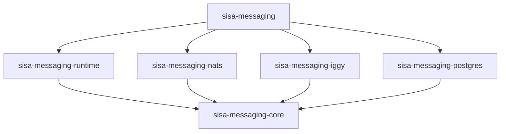

# Architecture

A map of the design for contributors, as 0.1.0 ships it. What each type does for users is in its
Rust docs; this page explains how the parts fit, what they promise, and which rules hold them
together. [Flows](02-flows.md) draws each step described here, and [Research](03-research.md) says
where the ideas come from.

## Goals

- **Pick the parts at startup.** A transport (NATS and Iggy first, then the Kafka family, RabbitMQ
  and LavinMQ), a persistence (PostgreSQL first, then MySQL and SQL Server) and a codec (JSON
  first, then MessagePack and Avro). Handlers and publishing code don't change when a part does.
- **The outbox and the inbox are optional.** An application can use plain messaging, add an
  outbox so a message is published if and only if its database transaction commits, and add an
  inbox so a redelivered message is skipped instead of handled twice.
- **At least once, everywhere.** No mode loses a message the broker or the database accepted.
  With the inbox, a handler's database work happens once per endpoint and message.
- **A shared, documented wire format.** Services in other languages publish and consume the same
  messages: the envelope follows CloudEvents 1.0 in each transport's binary mode.
- **Small and explicit.** Building a bus is all the setup; it runs its own workers. Each part has
  one way in and one way out.

## Words used everywhere

| Word | Meaning |
| --- | --- |
| **Message** | A Rust type that implements `Message`: serde for its data, and a `TYPE` such as `orders.order_placed.v1` |
| **Message type** | The CloudEvents `type`: levels of `[a-z0-9_]` joined by `.`, ending with the version of the message's shape. It is valid as a NATS subject, a Kafka topic and an AMQP routing key, so it is the default destination |
| **Envelope** | A message on its way, as a CloudEvent: its id, type, source, time, content type, partition key, correlation, trace context, other extensions, and the encoded data |
| **Codec** | Turns a message into bytes and back, and names the content type, such as `application/json` |
| **Transport** | Moves envelopes: publishes them to the broker and delivers them to endpoints |
| **Endpoint** | A named, durable subscription, such as `billing`. Every instance of a service shares its endpoint (competing consumers), and each endpoint gets its own copy of every message it subscribes to (fan-out) |
| **Handler** | Application code that handles one message type on one endpoint |
| **Bus** | What the application holds: it publishes, and it runs the endpoints, their handlers and the workers |
| **Publisher** | The trait with `publish`. The bus publishes straight to the broker, the outbox publisher writes a row in the caller's transaction, and a handler's context does what its endpoint is set up for |
| **Store** | A persistence's side of the outbox, the inbox or the partitions: only the SQL. The runtime holds the logic around it |
| **Outbox** | The `outbox_messages` table in the application's database. `bus.outbox(&mut tx).publish(..)` writes a row there in the caller's transaction, and the **dispatcher** publishes the row after the commit and marks it dispatched |
| **Inbox** | The `inbox_receipts` table: a receipt per `(endpoint, message id)` handled, written in the handler's transaction, so a redelivery is acknowledged without running the handler again |
| **Partition** | One time range of a table, a day by default. Both tables are partitioned, so old data leaves by whole partitions, never by `DELETE` |
| **Retention** | How long a partition is kept before it is detached (kept as a table of its own, for archiving) or dropped. Off by default: outbox and inbox rows are business data |

## Crates



| Crate | Published | Main types | What it holds |
| --- | --- | --- | --- |
| `sisa-messaging` | Yes | Everything below that an application uses | Re-exports only, no code of its own; features `nats`, `iggy` and `postgres` pick the parts, none by default |
| `sisa-messaging-core` | Yes | `Message`, `Envelope`, `MessageId`, `MessageType`, `Codec`, `JsonCodec`, `TransportPublisher`, `TransportSubscriber`, `Delivery`, `OutboxStore`, `InboxStore`, `PartitionStore`, `Publisher` | Contracts only, and the JSON codec. No runtime, no SQL, no broker client, so adapter crates build fast |
| `sisa-messaging-runtime` | Yes | `Bus`, `BusBuilder`, `EndpointBuilder`, `OutboxPublisher`, `HandlerContext`, `Handler`, `RetryPolicy`, `DispatchSettings`, `PartitionSettings`, `InMemoryTransport` | The engine, the same for every transport and database: the bus, the receive pipeline with the inbox step, the dispatcher, the partition maintenance scheduler, retries, and an in-memory transport for tests |
| `sisa-messaging-nats` | Yes | `NatsTransport`, `NatsSettings`, `NatsDelivery` | Both transport halves on JetStream: a stream per prefix, a durable pull consumer per endpoint |
| `sisa-messaging-iggy` | Yes | `IggyTransport`, `IggySettings`, `IggyDelivery` | Both transport halves on Iggy: a topic per message type in one stream, a consumer group per endpoint and topic, and the per-message retry a log doesn't have |
| `sisa-messaging-postgres` | Yes | `PostgresOutbox`, `PostgresInbox`, `PostgresPartitions` | The three stores: the row writes, the claim, the receipt, the partition DDL and the advisory lock. Only SQL; the tables come from the migrations in [`migrations/postgresql`](../migrations/postgresql) |
| `sisa-messaging-testing` | No | `Nats`, `Postgres`, `Iggy`, `eventually` | A NATS, a PostgreSQL and an Iggy container per test, and a wait-until helper |

Later crates follow the same shape: `-kafka` (Kafka, Redpanda, WarpStream), `-amqp` (RabbitMQ,
LavinMQ), `-mysql`, `-mssql`, `-msgpack`, `-avro`. A database crate implements the store
traits and nothing else, so MySQL and SQL Server add only their SQL: the claim (`FOR UPDATE SKIP
LOCKED`, or `READPAST` with `UPDLOCK`), the partition DDL and the lock differ in every dialect,
and SQL Server uses tiberius rather than sqlx, so there is no shared SQL crate. JSON stays in
core: serde is a bound on every message anyway.

## The contracts

Sketches, to show where each responsibility sits. The code settles the exact signatures.

### Message and envelope

```rust,ignore
pub trait Message: Serialize + DeserializeOwned + Send + Sync + 'static {
    /// The CloudEvents `type`, such as `orders.order_placed.v1`.
    const TYPE: &'static str;
}

pub struct Envelope {
    pub id: MessageId,                  // ce-id: UUID version 7, so ids sort by creation time
    pub message_type: MessageType,      // ce-type: the `Message::TYPE`
    pub source: Source,                 // ce-source: the publishing service, such as `/orders`
    pub time: Timestamp,                // ce-time
    pub subject: Option<String>,        // ce-subject: what the message is about, such as an order id
    pub content_type: ContentType,      // ce-datacontenttype: from the codec
    pub data_schema: Option<String>,    // ce-dataschema: for Avro later
    pub partition_key: Option<String>,  // ce-partitionkey: messages with one key keep their order
    pub correlation: Correlation,       // ce-correlationid, ce-causationid
    pub trace: Option<TraceContext>,    // ce-traceparent, ce-tracestate (W3C)
    pub extensions: Extensions,         // any other ce- attribute, kept as it came
    pub data: Bytes,
}

pub struct Correlation {
    pub correlation_id: Option<MessageId>,  // ties a conversation together
    pub causation_id: Option<MessageId>,    // the message being handled when this one was published
}

pub struct TraceContext {
    pub traceparent: String,
    pub tracestate: Option<String>,  // passed on unchanged, as W3C Trace Context requires
}
```

The fields are grouped in Rust and flat on the wire, where each CloudEvents binding wants one
header per attribute. Correlation and trace are typed fields, not extensions, because the runtime
sets and carries them: a handler's publishes get the handled message as their causation, its
correlation id, and its trace context unchanged. `extensions` holds what the runtime doesn't
interpret.

### Codec

```rust,ignore
pub trait Codec: Send + Sync + 'static {
    fn content_type(&self) -> &'static str;
    fn encode<Msg: Message>(&self, message: &Msg) -> Result<Bytes, CodecError>;
    fn decode<Msg: Message>(&self, data: &[u8]) -> Result<Msg, CodecError>;
    /// Whether it reads data of this content type; by default, when the media types match.
    fn can_decode(&self, content_type: &ContentType) -> bool { .. }
}
```

A bus has one codec, `JsonCodec` unless `BusBuilder::codec` sets another, such as MessagePack or
Avro over serde. `Codec` has generic methods, so the codec is a type parameter with `JsonCodec` as
its default: `Bus<Transport, Outbox, Codec>`, and handlers take `HandlerContext<Transaction,
Codec>`. Every publish, the outbox's and the handlers' included, is encoded with it, and every
handler decodes with it; a delivery whose content type it can't decode goes to the error
destination at once. Picking the codec by the envelope's content type, so a service can move to
another codec while old messages drain, would need a codec chosen at run time.

The library encrypts nothing. An application that must encrypts the data with a codec that wraps
another, or encrypts fields in the message itself. Either way only the data is encrypted: the
CloudEvents attributes go in the headers and the outbox's columns as they are.

### Transport

Two halves, so the dispatcher and a publish-only service need only the first. `NatsTransport`
and `IggyTransport` implement both.

```rust,ignore
pub trait TransportPublisher: Send + Sync + 'static {
    /// Returns once the broker has the envelope: a JetStream publish acknowledgement, a Kafka
    /// produce acknowledgement, a RabbitMQ publisher confirm.
    async fn publish(&self, envelope: &Envelope) -> Result<(), TransportError>;
}

pub trait TransportSubscriber: Send + Sync + 'static {
    type Delivery: Delivery;
    /// Creates the endpoint's durable subscription if needed, and streams its deliveries.
    async fn subscribe(&self, endpoint: &EndpointSpec) -> Result<Deliveries<Self::Delivery>, TransportError>;
    /// Publishes an envelope the endpoint gave up on to its error destination.
    async fn publish_error(&self, endpoint: &str, envelope: &Envelope) -> Result<(), TransportError>;
}

pub trait Delivery: Send + 'static {
    fn envelope(&self) -> &Envelope;
    fn attempt(&self) -> u32;                 // 1 on the first delivery
    async fn ack(self) -> Result<(), TransportError>;
    async fn retry(self, delay: Duration) -> Result<(), TransportError>;
    async fn reject(self) -> Result<(), TransportError>; // no more attempts
}
```

### Stores

A database crate implements three narrow traits. Everything around them (when to claim, how long
the lease is, the backoff, when to give up, when to create and expire partitions) is in the
runtime, once for every database.

```rust,ignore
pub trait OutboxStore: Send + Sync + 'static {
    type Connection: ?Sized;  // sqlx::PgConnection; sqlx::MySqlConnection; a tiberius client

    /// Writes the rows on the caller's connection, inside the caller's transaction.
    async fn insert(&self, connection: &mut Self::Connection, envelopes: &[Envelope]) -> Result<()>;

    // The dispatcher's side, on the store's own pool. Each call commits before it returns, and
    // due times come from the database's clock. An `OutboxRecord` is the envelope, the row's
    // `created_at`, its failed attempts and when the claim's lease runs out, which each mark
    // matches, so a dispatcher whose lease ran out can't overwrite a newer claim.
    async fn claim(&self, limit: usize, lease: Duration) -> Result<Vec<OutboxRecord>>;
    async fn mark_dispatched(&self, records: &[OutboxRecord]) -> Result<()>;
    async fn mark_retry(&self, record: &OutboxRecord, error: &str, delay: Duration) -> Result<()>;
    async fn mark_failed(&self, record: &OutboxRecord, error: &str) -> Result<()>;
}

pub trait InboxStore: Send + Sync + 'static {
    type Transaction: DerefMut + Send;  // sqlx::PgTransaction<'static>; dropping it rolls it back

    async fn begin(&self) -> Result<Self::Transaction>;
    /// Writes the receipt; false when the endpoint recorded this message before.
    async fn record(&self, tx: &mut Self::Transaction, endpoint: &str, envelope: &Envelope) -> Result<bool>;
    async fn commit(&self, tx: Self::Transaction) -> Result<()>;
}

pub trait PartitionStore: Send + Sync + 'static {
    async fn try_lock(&self) -> Result<Option<PartitionLock>>;  // one instance at a time
    /// Fills the days that no partition holds yet, so a changed interval starts where the old partitions end.
    async fn ensure_partitions(&self, interval: PartitionInterval, from: Date, count: u32) -> Result<()>;
    async fn default_rows(&self) -> Result<u64>;  // the worker warns while it isn't 0
    async fn expirable(&self, older_than: Date) -> Result<Vec<PartitionInfo>>;  // with pending and failed counts
    async fn expire(&self, partition: &PartitionInfo, mode: Expiry) -> Result<()>;
}
```

### Bus, publishers and handlers

One trait publishes, whatever the mode:

```rust,ignore
pub trait Publisher {
    type Error: Error + Send + Sync + 'static;  // PublishError for all three below
    async fn publish<Msg: Message>(&mut self, message: &Msg) -> Result<(), Self::Error>;
}
```

Three types implement it, and the code that owns the transaction picks one:

| Publisher | Where it sends | When to use it |
| --- | --- | --- |
| `Bus` | Straight to the broker; returns when the broker has it | Outside a database transaction: before it begins or after it commits |
| `OutboxPublisher`, from `bus.outbox(&mut tx)` | A row in `outbox_messages`, in the caller's transaction; the dispatcher sends it after the commit | Inside the caller's transaction, so the message goes out if and only if it commits |
| `HandlerContext` | As the endpoint is set up: a row in the handler's transaction on an endpoint with an inbox and a bus with an outbox, otherwise held and sent after the handler succeeds | Inside a handler |

```rust,ignore
type AppBus = Bus<NatsTransport, PostgresOutbox>;

let bus: AppBus = Bus::builder("/orders", NatsTransport::connect(NatsSettings::default()).await?)
    .outbox(PostgresOutbox::new(pool.clone())) // optional; changes the type
    .partitions(PostgresPartitions::outbox(pool.clone()), PartitionSettings::default())
    .endpoint("billing", |endpoint| {
        endpoint.inbox(PostgresInbox::new(pool.clone())) // optional; after the outbox
            .handle::<OrderPlaced>(charge_order)
    })
    .start()
    .await?;

// Direct, outside a transaction.
bus.publish(&OrderPlaced { id }).await?;

// Through the outbox: the application opens and commits its own transaction, as usual.
let mut tx = pool.begin().await?;
sqlx::query("insert into orders ...").execute(&mut *tx).await?;
bus.outbox(&mut tx).publish(&OrderPlaced { id }).await?;
tx.commit().await?;

// Domain code doesn't care which one it gets.
async fn place_order<P: Publisher>(publisher: &mut P, order: Order) -> Result<(), P::Error> { .. }
```

The bus carries its outbox in its type. `outbox` exists only on a bus built with one, and
accepts only that store's connection type, so a missing outbox or a transaction from another
database is a compile error, never a silent direct send. `bus.outbox(&mut tx)` borrows the
transaction only for the call, so the application keeps using `tx` between publishes.

A handler gets the message and a `HandlerContext`. The context publishes with the handled message
as the causation, and its correlation id and trace context carried over unchanged. On an endpoint
with an inbox, it also hands out the delivery's transaction: the handler takes `&mut HandlerContext<PgTransaction<'static>>` and runs its
queries on `context.transaction()`.

```rust,ignore
async fn charge_order(
    order: OrderPlaced,
    context: &mut HandlerContext<PgTransaction<'static>>,
) -> Result<(), HandlerError> {
    sqlx::query("insert into charges ...").execute(context.transaction()).await?;
    context.publish(&InvoiceSent { order: order.id }).await?; // an outbox row in the same transaction
    Ok(())
}
```

An endpoint's inbox must write in a transaction the bus's outbox can write in too, so an inbox and
an outbox on different databases don't compile. The bus checks this when the endpoint is added,
so the outbox comes first; an endpoint with an inbox added before it fails `start`.

## How each mode behaves

| Mode | A publish from application code | A publish from a handler | A redelivered message |
| --- | --- | --- | --- |
| Plain | Goes to the broker; returns when the broker has it | Held until the handler returns `Ok`, then sent before the ack | Handled again: the handler must be idempotent |
| Outbox | `bus.outbox(&mut tx).publish` writes a row; the dispatcher publishes it after the commit. `bus.publish` still goes straight to the broker | On an endpoint with an inbox, a row in the handler's transaction; otherwise as in plain mode | Handled again |
| Outbox and inbox | As above | A row in the handler's transaction | The inbox row exists, so the delivery is acked and the handler doesn't run |

An endpoint with an inbox runs each delivery in a transaction of the inbox store's, since its row
has to commit with the handler's work; there is no transactional endpoint without an inbox. The
inbox works without the outbox too: the handler's publishes are then sent after the commit, which leaves
a gap. A process that stops after the commit and before the send loses them, and so does a send
that fails and makes the endpoint retry the delivery: either way the inbox acks the redelivery
without running the handler again, so the publishes are never sent. Use the outbox with the inbox when those
publishes matter.

### Receiving

For each delivery, an endpoint:

1. Decodes the data with the bus's codec. Data of another content type or that doesn't decode, and a type the
   endpoint has no handler for, go to the error destination at once, without retries, since no
   retry can fix them; the delivery is rejected once that publish succeeds, as in step 5.
2. With an inbox, begins a transaction and records the message. A message recorded before is
   committed and acked here.
3. Runs the handler.
4. On success, writes the handler's publishes to the outbox (or holds them), commits, sends any
   held publishes, then acks.
5. On an error, rolls back and asks the transport to retry after the retry policy's delay: 5
   attempts by default, 1 second after the first failure and twice as long after each next one,
   at most a minute. A handler that panics fails like one that returns an error. Past
   the policy's last attempt, it publishes the envelope to the endpoint's error destination with
   the error in its headers, then rejects the delivery. If that publish fails, the delivery is
   retried after the policy's delay instead of rejected, so a message is never dropped without a
   copy in the error destination.

### Dispatching the outbox

The dispatcher is a runtime worker the bus starts when it has an outbox; a store only claims and
marks rows. Each round it claims a batch of due rows, publishes them in id order (UUID version 7,
so creation order), waiting for the broker each time, and marks them
`dispatched` with the time. A row that fails is put back with a later due time and its error, and
its `attempts` counts one more failure; past the last attempt it is marked `failed` and left for a
person to look at; setting it back to `pending` sends it again. Claiming moves the due
time forward by a lease, so the rows of a dispatcher that dies come back once the lease runs out,
and several instances claim different rows. A dispatcher publishes no row of a batch whose lease
ran out, and gives up waiting on a publish when the lease runs out, since another instance may hold
the row by then. The envelope keeps its id in the outbox, so a
row published twice (a crash between the publish and the mark) reaches the broker with the same
id: JetStream drops it inside its duplicate window, Iggy keeps both, and an inbox drops it after. A row that doesn't
read back as an envelope is marked `failed` by the claim, so it can't hold up the others.

`DispatchSettings` sets the poll interval (1 second), the batch size (100), the lease (30
seconds) and the retry policy (10 attempts, 1 second apart at first, at most a minute apart). A
round that published a full batch is followed by the next at once.

### Partitions and retention

Rows are never deleted one by one: the outbox and inbox are the application's record of what it
sent and handled. Both tables are range-partitioned by time, one partition per day by default.

- **The outbox** is partitioned by `created_at`, when the row was written.
- **The inbox** is partitioned by `message_time`, the envelope's own `time`, not by when the
  receipt was written. A redelivery carries the same envelope, so its receipt falls in the same
  partition and the primary key catches it, however many days later it comes.
- **Maintenance** is a runtime worker the bus starts for each table given to
  `BusBuilder::partitions`, such as `PostgresPartitions::outbox(pool)`; the store only runs the
  DDL. Once an hour, with one instance at a time through a session advisory lock on the table, it
  creates the partitions for the current interval and the next 7 (`PartitionSettings::ahead`), a
  day, week or month each (`interval`), and applies the retention. `PartitionMode::External` in
  `partitions` turns it off for teams that use pg_partman or their own jobs.
- **Retention** is off by default. When set, such as `retention_days = Some(90)`, a partition older
  than that is detached, which keeps it as an ordinary table for archiving, or dropped with
  `on_expiry = Expiry::Drop`. An outbox partition that still holds `pending` or `failed` rows is never
  expired; the worker warns instead. Keep the inbox retention longer than the longest redelivery, or a very
  late redelivery is handled again.
- **A default partition** catches a row whose time has no partition yet, such as a message from a
  publisher with a clock far off. The worker warns while it holds rows, since PostgreSQL can't
  create a partition over rows already sitting in the default one.

## Data formats

Services in other languages share messages and tables by following these formats. They change only
with a version bump that the changelog calls out.

### Envelope on the wire

[CloudEvents 1.0](https://github.com/cloudevents/spec/blob/main/cloudevents/spec.md) in binary
content mode: the attributes go in the transport's headers and the body is the encoded message, so
consumers that don't know CloudEvents still read a plain body.

| Attribute | Required | Value |
| --- | --- | --- |
| `specversion` | Yes | `1.0` |
| `id` | Yes | The message id, a UUID version 7 |
| `source` | Yes | A URI reference naming the publishing service, set once per bus, such as `/orders` |
| `type` | Yes | The message type, such as `orders.order_placed.v1` |
| `time` | Yes | When it was published, RFC 3339 with a year from 0000 to 9999 and no leap second |
| `datacontenttype` | Yes | The codec's content type, such as `application/json` |
| `subject` | No | What the message is about within the source, such as an order id |
| `dataschema` | No | The schema's URI, for Avro and other schema codecs |
| `partitionkey` | No | Messages with one key keep their order; the CloudEvents Partitioning extension. The Kafka message key; a NATS subject token later |
| `traceparent`, `tracestate` | No | W3C Trace Context, per the CloudEvents Distributed Tracing extension |
| `correlationid` | No | Our extension: the id that ties a conversation together |
| `causationid` | No | Our extension: the id of the message whose handler published this one |
| `errorendpoint`, `errortype`, `errormessage`, `errorattempts` | Error destination only | Our extensions: where and why handling gave up |

Our extension names follow the CloudEvents rules (lowercase letters and digits, at most 20
characters), so other CloudEvents SDKs carry them. Receivers read binary mode only: on NATS and Iggy, a
message whose `ce-` or `ce_` headers don't make an envelope, such as one in structured mode, goes to the
endpoint's error destination as it came, with `errorendpoint`, `errortype` and `errormessage`, and
isn't handled.

In 0.1.0 the publishers set neither `subject`, `dataschema` nor `partitionkey`, and a message
published outside a handler has no `correlationid`; envelopes from other producers keep the ones
they carry, through the outbox and the inbox too.

Each transport names the headers as its CloudEvents binding says. Iggy has no binding, so it
follows Kafka's, the closest one, and keeps every attribute in a header:

| Transport | Header names | Example |
| --- | --- | --- |
| NATS | `ce-` and the attribute | `ce-id`, `ce-type`, `ce-datacontenttype` |
| Kafka family | `ce_` and the attribute | `ce_id`, `ce_type`; `content-type` for the content type |
| Iggy | `ce_` and the attribute, as string user headers; the Iggy message id is the message id | `ce_id`, `ce_type`, `ce_datacontenttype` |
| AMQP | `cloudEvents:` and the attribute, from the AMQP 1.0 binding, since AMQP 0-9-1 has none | `cloudEvents:id`; the content type in the `content_type` property |

On NATS the publish also sets `Nats-Msg-Id` to the message id, so JetStream drops a duplicate
publish inside the stream's duplicate window. A copy to the error subject goes without it, so the
stream keeps it next to the original of the same id. Iggy has no deduplication by id, so it keeps
every publish. An Iggy header value holds at most 255 bytes: a publish with a longer attribute
fails, and an error copy cuts it there.

### NATS subjects and streams

| Thing | Name | Example |
| --- | --- | --- |
| Subject | `{prefix}.{message type}` | `sisa.orders.order_placed.v1` |
| Stream | One per prefix, capturing `{prefix}.>` | `SISA`, on `sisa.>` |
| Durable consumer | The endpoint name, filtered on the subjects of the messages it handles. A new one starts with the messages published after it is created; an existing one keeps its subjects and gains the missing ones | `billing` |
| Error subject | `{prefix}._error.{endpoint}` | `sisa._error.billing` |

The prefix keeps deployments that share a server apart, such as `prod` and `staging`. Give each
its own stream too: connecting sets the stream's subjects to its prefix's.

### Iggy streams and topics

| Thing | Name | Example |
| --- | --- | --- |
| Stream | `IggySettings::stream`, created on connect | `sisa` |
| Topic | The message type, created on the first publish or subscribe with `IggySettings::partitions` partitions (4 by default) | `orders.order_placed.v1` |
| Consumer group | The endpoint name, on the topic of each message type it handles. A new group reads each partition from its first message, so a new endpoint also gets what is already in its topics | `billing` on `orders.order_placed.v1` |
| Error topic | `_error.{endpoint}`, one partition | `_error.billing` |

The stream keeps deployments that share a server apart, such as `prod` and `staging`. An
endpoint's instances share its group's partitions, so a topic's partitions cap how many of them
work on it at once. A message with a `partitionkey` goes to the partition its key picks.

Iggy acknowledges a position in a partition, not one message, so `IggyDelivery` builds the rest:
`ack` and `reject` commit the message's offset; `retry` holds its partition and reads it again from
that offset once the delay has passed, so the messages behind it wait and the partition keeps its
order; a delivery dropped unsettled is retried at once. The attempt is counted in memory, so it
starts from 1 again after a restart or a rebalance. An endpoint that stops handling a type stops
reading that topic, where NATS keeps the type in its consumer's filter.

### PostgreSQL tables

Created by the SQL migrations in [`migrations/postgresql`](../migrations/postgresql), which the
application runs itself: with `sqlx migrate run --source migrations/postgresql` in its deploy
pipeline, or by hand with psql, into a schema created beforehand. Pick one way per schema: a psql
run leaves no row in `_sqlx_migrations`, so a later `sqlx migrate run` would run the migration again
and fail. The SQL names no schema, so the connection's `search_path` picks it, for the migrations
and for the queries alike, such as `options=-c search_path=messaging` in the URL. A schema of its
own also keeps sqlx's `_sqlx_migrations` table for these migrations apart from the application's.
Columns that hold a CloudEvents attribute take its name. A primary key on a partitioned table must
hold the partition key, so each one starts with it.

Every constraint and index is named in the SQL, never left to PostgreSQL or a tool to generate,
so the names stay the same across versions and the next migration can refer to them. A name is a
two-letter prefix and the table, then the columns or purpose, within PostgreSQL's 63 characters:

| Prefix | Object | Example |
| --- | --- | --- |
| `pk_` | Primary key | `pk_outbox_messages` |
| `uq_` | Unique constraint | `uq_inbox_receipts_endpoint_message` |
| `fk_` | Foreign key | none yet |
| `ck_` | Check constraint | `ck_outbox_messages_status` |
| `ix_` | Index | `ix_outbox_messages_due` |

Constraints go inside `CREATE TABLE`. PostgreSQL has no inline index syntax, so an index that
isn't backing a constraint, such as the partial one for the claim, is a `CREATE INDEX` right after
its table. A partition's own copies of these get names PostgreSQL derives from the partition
table; nothing refers to them.

```sql
CREATE TABLE outbox_messages (
    id                uuid        NOT NULL,              -- the message id, UUID v7: claim order
    created_at        timestamptz NOT NULL DEFAULT now(), -- the partition key
    type              text        NOT NULL,              -- the message type, which picks the destination
    source            text        NOT NULL,
    subject           text,
    partition_key     text,
    data_content_type text        NOT NULL,
    data_schema       text,
    attributes        jsonb       NOT NULL,              -- time, correlation, trace, extensions
    data              bytea       NOT NULL,
    status            text        NOT NULL DEFAULT 'pending',
    available_at      timestamptz NOT NULL DEFAULT now(),     -- due time, moved forward by a claim
    attempts          integer     NOT NULL DEFAULT 0,
    last_error        text,
    dispatched_at     timestamptz,
    CONSTRAINT pk_outbox_messages PRIMARY KEY (created_at, id),
    CONSTRAINT ck_outbox_messages_status CHECK (status IN ('pending', 'dispatched', 'failed'))
) PARTITION BY RANGE (created_at);
CREATE INDEX ix_outbox_messages_due ON outbox_messages (available_at, id)
    WHERE status = 'pending';
CREATE INDEX ix_outbox_messages_id ON outbox_messages (id);

CREATE TABLE inbox_receipts (
    id             uuid        NOT NULL,                 -- the receipt's own id, UUID v7
    message_time   timestamptz NOT NULL,                 -- the envelope's time: the partition key
    endpoint       text        NOT NULL,
    message_id     uuid        NOT NULL,
    type           text        NOT NULL,
    source         text        NOT NULL,
    correlation_id uuid,
    attributes     jsonb       NOT NULL,
    data           bytea,                                -- kept only with `keep_data(true)`
    received_at    timestamptz NOT NULL DEFAULT now(),
    CONSTRAINT pk_inbox_receipts PRIMARY KEY (message_time, id),
    CONSTRAINT uq_inbox_receipts_endpoint_message        -- the deduplication
        UNIQUE (endpoint, message_id, message_time)
) PARTITION BY RANGE (message_time);

-- For each table, the partitions for today and the next 7 intervals and a default partition,
-- made by the migration so the first write has a partition, then kept ahead by the maintenance
-- worker. Days are UTC days: the bounds carry `+00`, so the session's time zone doesn't move them.
CREATE TABLE outbox_messages_p20261102 PARTITION OF outbox_messages
    FOR VALUES FROM ('2026-11-02 00:00+00') TO ('2026-11-03 00:00+00');
CREATE TABLE outbox_messages_default PARTITION OF outbox_messages DEFAULT;
CREATE TABLE inbox_receipts_p20261102 PARTITION OF inbox_receipts
    FOR VALUES FROM ('2026-11-02 00:00+00') TO ('2026-11-03 00:00+00');
CREATE TABLE inbox_receipts_default PARTITION OF inbox_receipts DEFAULT;
```

The outbox orders by `id` instead of a sequence column: a UUID version 7 starts with its
millisecond, and one process makes them in order inside a millisecond. Rows from two instances in
the same millisecond may swap, which the guarantees already allow.

A claim is one statement. The partial index holds only pending rows, so old partitions cost the
claim next to nothing. `RETURNING` has no order of its own, so the outer query sorts the claimed
rows:

```sql
WITH claimed AS (
    UPDATE outbox_messages
    SET available_at = now() + $2
    WHERE (created_at, id) IN (
        SELECT created_at, id FROM outbox_messages
        WHERE status = 'pending' AND available_at <= now()
        ORDER BY id
        LIMIT $1
        FOR UPDATE SKIP LOCKED
    )
    RETURNING *
)
SELECT * FROM claimed ORDER BY id;
```

A receipt is `INSERT ... ON CONFLICT DO NOTHING`; no row inserted means a duplicate.

## Guarantees and limits

| | |
| --- | --- |
| **Guaranteed** | A `publish` that returns `Ok` is in the broker. |
| **Guaranteed** | With the outbox, a publish through `bus.outbox(&mut tx)` whose transaction commits is published after the commit, or, when every attempt fails, kept as a `failed` row until someone sends it again; one whose transaction rolls back is never published. |
| **Guaranteed** | A delivery is acked only after its handler succeeded and, on an endpoint with an inbox, its transaction committed. |
| **Guaranteed** | With the inbox, a handler's transaction commits at most once per endpoint and message id, while the inbox row is kept. |
| **Not guaranteed** | A handler's publishes with the inbox and no outbox: they are sent after the commit, so a process that stops in between, or a send that fails, loses them, and the inbox skips the redelivery. |
| **Not guaranteed** | Exactly-once delivery. Every mode is at least once: a handler without the inbox can see a message twice, and anything it does outside the transaction can happen twice even with it. |
| **Not guaranteed** | Order. Several dispatchers claim different rows, and retries put a failed message behind later ones. Envelopes carry a `partitionkey` from the start; keeping order per key is on the [roadmap](../ROADMAP.md). |
| **Not guaranteed** | A message the broker dropped before any endpoint handled it. A JetStream stream with `max_age`, `max_msgs` or `max_bytes`, a Kafka topic's retention, or an Iggy topic's `message_expiry` or `max_topic_size`, removes unacked messages too: keep it longer than the longest consumer outage. The stream `NatsTransport` creates and the topics `IggyTransport` creates have no limits, and connecting updates the stream to `NatsSettings`, which also clears limits set on it by hand. |
| **Not guaranteed** | A message redelivered after its receipt's partition expired is handled again. Keep the inbox retention longer than the longest redelivery. |
| **Not guaranteed** | Deduplication of a message whose `time` was changed between deliveries: the receipt's partition comes from it. Publishers never change it; a hand-made republish must keep it. |

## Decisions

Settled; reopen only with new evidence.

| Decision | Why |
| --- | --- |
| CloudEvents 1.0 binary mode is the envelope, with the standard tracing and partitioning extensions and our own `correlationid` and `causationid` | One documented format that NATS, Kafka and AMQP each have a binding for, so other languages and tools read our messages without a library of ours |
| Message ids are UUID version 7, made by the publisher | Ids stay stable across outbox retries and broker redeliveries, which the inbox and broker deduplication need; v7 sorts by time, which keeps the inbox index compact |
| The outbox is written on the caller's connection, never on a connection of its own | Only the caller's transaction makes the row commit or roll back with the business data |
| Outbox and inbox rows are never deleted one by one; whole partitions expire, and only when a retention is set | The rows are business data. Expiring a partition is one cheap statement that leaves no bloat, where deleting rows needs vacuum and slows the claim |
| The inbox is partitioned by the envelope's `time`, not by when the receipt was written | A primary key on a partitioned table only holds inside one partition, so a redelivery must land in the same partition as its first receipt |
| An expired partition is detached by default, dropped only when asked | Detaching keeps the data as a table to archive or query; dropping it is the step nobody can undo |
| The tables come from plain SQL migrations in `migrations/postgresql`, which the application runs with sqlx-cli or by hand; the SQL names no schema, and the connection's `search_path` picks it | Applications already run sqlx migrations in their deploy pipelines, and a schema per deployment needs no setting of ours. Run in a schema of their own, the migrations keep their own `_sqlx_migrations` table there |
| NATS uses JetStream, not core NATS | Core NATS has no acknowledgement or redelivery, so it can't be at least once |
| An Iggy retry holds its partition and reads it again from the message's offset; retry topics come with the Kafka family | A log commits positions, not messages, so a later message can't be committed past a failed one without losing it on a crash. Holding the partition keeps the order and needs no extra topics |
| Transports, persistences and codecs are open traits | Users asked to bring their own; sealing them would rule that out. Their docs say which changes a minor release may make |
| The engine lives in `sisa-messaging-runtime`; database crates implement only store traits; the facade has no code | The dispatcher, the inbox step and partition maintenance would otherwise be copied into every database crate, where only the SQL differs |
| One `Publisher` trait; the outbox publisher borrows the caller's transaction, and exists only on a bus built with an outbox | One signature for domain code, while the guarantee stays visible where the transaction lives and a missing outbox fails to compile instead of silently sending direct |
| The transport is two traits, publish and subscribe | The dispatcher and publish-only services need only the publish half |
| The message's routing name is its CloudEvents `type` | One word from the Rust trait to the wire to the table |
| The outbox orders by its UUID v7 id; no sequence column | Ids already sort by creation, one column fewer, and MySQL and SQL Server need no identity column on a partitioned table |
| JSON lives in core | Every message is serde already; other codecs get crates of their own |
| The minimum Rust is 1.95 | The iggy client needs it; sqlx 0.9 needs 1.94 |

## Rules that hold the design together

- A delivery is acked after the work it caused is durable, never before, and never on an error
  path.
- No transaction is held across a transport call: publishes held by a handler go out after the
  commit, and the dispatcher's claim commits before it publishes.
- The outbox and inbox SQL never names a schema; the connection's `search_path` picks it.
- Only the clock module reads the wall clock.
- No code deletes outbox or inbox rows; data leaves only by expiring a partition, and an outbox
  partition with pending or failed rows never expires.
- A bus starts each of its workers once (the dispatcher, the partition maintenance, one receive
  loop per endpoint), and stops them when it shuts down or its last clone drops.
