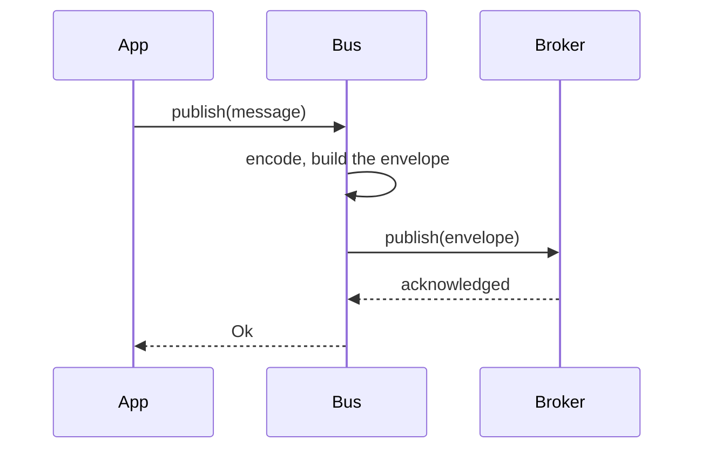
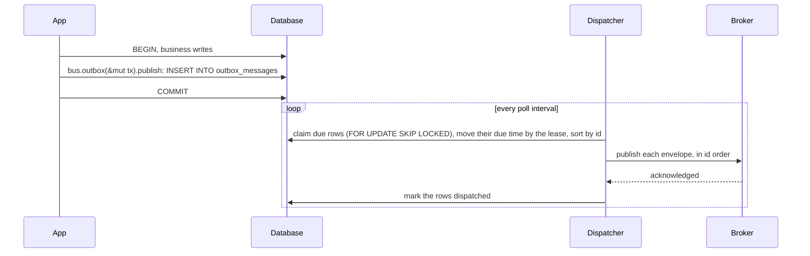
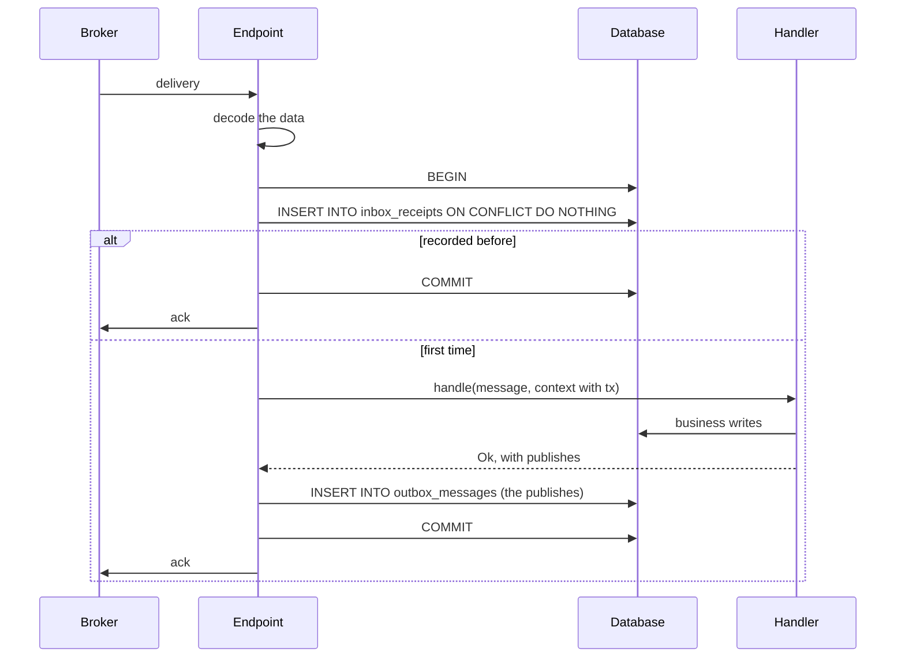
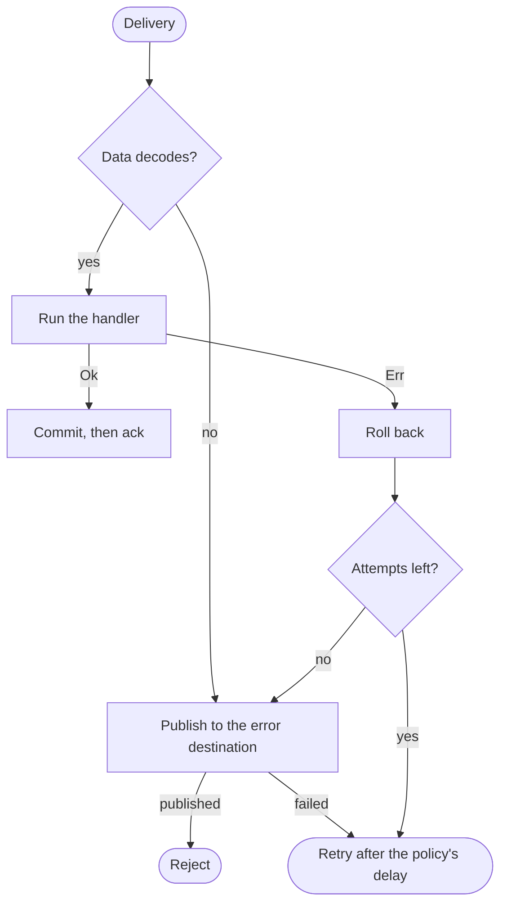
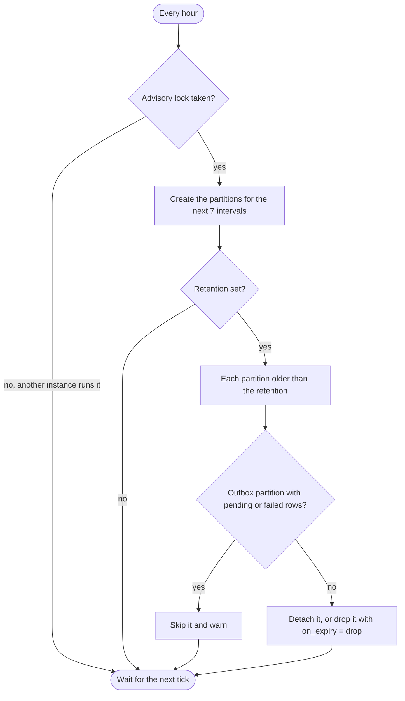

# Flows

Diagrams of each step that [Architecture](01-architecture.md) describes.

## Publishing without an outbox

If the application's database transaction then fails, the message is out anyway. That is what the
outbox prevents.

## Publishing through the outbox

A rollback removes the outbox row with the business writes, so nothing is published. A dispatcher
that crashes after publishing and before marking leaves rows that come back when the lease runs
out; they are published again with the same message id.

## Receiving on an endpoint with an inbox

## Handler errors and retries

## Partition maintenance

