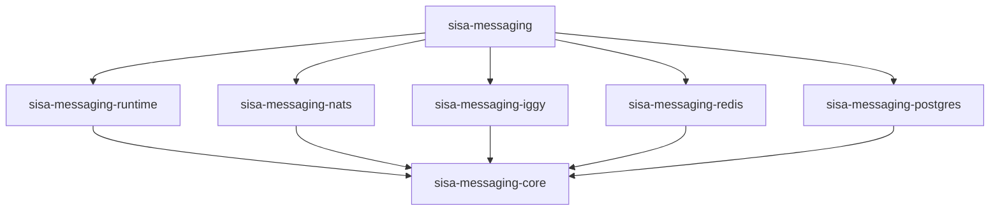

# Architecture

How the crates fit together, as 0.1.0 ships them: the goals, the crate map, what each mode
promises, and the rules that hold the design together. What each crate does is in its
[spec](specs/README.md); what goes over the wire and into the tables is in [Formats](formats.md);
[Flows](flows.md) draws each step; and the [decisions](adr/README.md) say why it is this way. The
words used everywhere are in the [docs index](README.md#words-used-everywhere).

## Goals

- **Pick the parts at startup.** A transport (NATS, Redis Streams and Iggy first, then the Kafka
  family, RabbitMQ and LavinMQ), a persistence (PostgreSQL first, then MySQL and SQL Server) and a codec (JSON
  first, then MessagePack and Avro). Handlers and publishing code don't change when a part does.
- **The outbox and the inbox are optional.** An application can use plain messaging, add an
  outbox so a message is published if and only if its database transaction commits, and add an
  inbox so a redelivered message is skipped instead of handled twice.
- **At least once, everywhere.** No mode loses a message the broker or the database accepted.
  With the inbox, a handler's database work happens once per endpoint and message.
- **A shared, documented wire format.** Services in other languages publish and consume the same
  messages: the envelope follows CloudEvents 1.0 in each transport's binary mode.
- **Small and explicit.** Building a bus is all the setup; it runs its own workers. Each part has
  one way in and one way out.

## Crates

| Crate and its spec | Published | Main types | What it holds |
| --- | --- | --- | --- |
| [`sisa-messaging`](specs/facade.md) | Yes | Everything below that an application uses | Re-exports only, no code of its own; features `nats`, `iggy`, `redis` and `postgres` pick the parts, none by default |
| [`sisa-messaging-core`](specs/core.md) | Yes | `Message`, `Envelope`, `MessageId`, `MessageType`, `Codec`, `JsonCodec`, `TransportPublisher`, `TransportSubscriber`, `Delivery`, `OutboxStore`, `InboxStore`, `PartitionStore`, `Publisher` | Contracts only, and the JSON codec. No runtime, no SQL, no broker client, so adapter crates build fast |
| [`sisa-messaging-runtime`](specs/runtime.md) | Yes | `Bus`, `BusBuilder`, `EndpointBuilder`, `OutboxPublisher`, `HandlerContext`, `Handler`, `RetryPolicy`, `DispatchSettings`, `PartitionSettings`, `InMemoryTransport` | The engine, the same for every transport and database: the bus, the receive pipeline with the inbox step, the dispatcher, the partition maintenance scheduler, retries, and an in-memory transport for tests |
| [`sisa-messaging-nats`](specs/nats.md) | Yes | `NatsTransport`, `NatsSettings`, `NatsDelivery` | Both transport halves on JetStream: a stream per prefix, a durable pull consumer per endpoint |
| [`sisa-messaging-iggy`](specs/iggy.md) | Yes | `IggyTransport`, `IggySettings`, `IggyDelivery` | Both transport halves on Iggy: a topic per message type in one stream, a consumer group per endpoint and topic, and the per-message retry a log doesn't have |
| [`sisa-messaging-redis`](specs/redis.md) | Yes | `RedisTransport`, `RedisSettings`, `RedisDelivery` | Both transport halves on Redis Streams, for Redis, Valkey and Dragonfly: a stream per message type, a consumer group per endpoint, and the delayed retry and takeover built from the pending entries |
| [`sisa-messaging-postgres`](specs/postgres.md) | Yes | `PostgresOutbox`, `PostgresInbox`, `PostgresPartitions` | The three stores: the row writes, the claim, the receipt, the partition DDL and the advisory lock. Only SQL; the tables come from the migrations in [`migrations/postgresql`](../migrations/postgresql) |
| [`sisa-messaging-testing`](specs/testing.md) | No | `Nats`, `Postgres`, `Iggy`, `Redis`, `eventually` | A NATS, a PostgreSQL, an Iggy and a Redis (or Valkey or Dragonfly) container per test, and a wait-until helper |

Later crates follow the same shape: `-kafka` (Kafka, Redpanda, WarpStream), `-amqp` (RabbitMQ,
LavinMQ), `-mysql`, `-mssql`, `-msgpack`, `-avro`. A database crate implements the store
traits and nothing else, so MySQL and SQL Server add only their SQL: the claim (`FOR UPDATE SKIP
LOCKED`, or `READPAST` with `UPDLOCK`), the partition DDL and the lock differ in every dialect,
and SQL Server uses tiberius rather than sqlx, so there is no shared SQL crate. JSON stays in
core: serde is a bound on every message anyway.

## How each mode behaves

| Mode | A publish from application code | A publish from a handler | A redelivered message |
| --- | --- | --- | --- |
| Plain | Goes to the broker; returns when the broker has it | Held until the handler returns `Ok`, then sent before the ack | Handled again: the handler must be idempotent |
| Outbox | `bus.outbox(&mut tx).publish` writes a row; the dispatcher publishes it after the commit. `bus.publish` still goes straight to the broker | On an endpoint with an inbox, a row in the handler's transaction; otherwise as in plain mode | Handled again |
| Outbox and inbox | As above | A row in the handler's transaction | The inbox row exists, so the delivery is acked and the handler doesn't run |

An endpoint with an inbox runs each delivery in a transaction of the inbox store's, since its row
has to commit with the handler's work; there is no transactional endpoint without an inbox. The
inbox works without the outbox too: the handler's publishes are then sent after the commit, which leaves
a gap. A process that stops after the commit and before the send loses them, and so does a send
that fails and makes the endpoint retry the delivery: either way the inbox acks the redelivery
without running the handler again, so the publishes are never sent. Use the outbox with the inbox when those
publishes matter.

The [runtime spec](specs/runtime.md#behaviour) has each step: receiving a delivery, dispatching
the outbox, and keeping and expiring partitions.

## Guarantees and limits

| | |
| --- | --- |
| **Guaranteed** | A `publish` that returns `Ok` is in the broker. |
| **Guaranteed** | With the outbox, a publish through `bus.outbox(&mut tx)` whose transaction commits is published after the commit, or, when every attempt fails, kept as a `failed` row until someone sends it again; one whose transaction rolls back is never published. |
| **Guaranteed** | A delivery is acked only after its handler succeeded and, on an endpoint with an inbox, its transaction committed. |
| **Guaranteed** | With the inbox, a handler's transaction commits at most once per endpoint and message id, while the inbox row is kept. |
| **Not guaranteed** | A handler's publishes with the inbox and no outbox: they are sent after the commit, so a process that stops in between, or a send that fails, loses them, and the inbox skips the redelivery. |
| **Not guaranteed** | Exactly-once delivery. Every mode is at least once: a handler without the inbox can see a message twice, and anything it does outside the transaction can happen twice even with it. |
| **Not guaranteed** | Order. Several dispatchers claim different rows, and retries put a failed message behind later ones. Envelopes carry a `partitionkey` from the start; keeping order per key is on the [roadmap](../ROADMAP.md). |
| **Not guaranteed** | A message the broker dropped before any endpoint handled it. A JetStream stream with `max_age`, `max_msgs` or `max_bytes`, a Kafka topic's retention, or an Iggy topic's `message_expiry` or `max_topic_size`, or a Redis `XTRIM` or `XADD` with `MAXLEN` or `MINID`, removes unacked messages too: keep it longer than the longest consumer outage. The stream `NatsTransport` creates, the topics `IggyTransport` creates and the streams `RedisTransport` creates have no limits, and connecting updates the stream to `NatsSettings`, which also clears limits set on it by hand. |
| **Not guaranteed** | A message redelivered after its receipt's partition expired is handled again. Keep the inbox retention longer than the longest redelivery. |
| **Not guaranteed** | Deduplication of a message whose `time` was changed between deliveries: the receipt's partition comes from it. Publishers never change it; a hand-made republish must keep it. |

## Rules that hold the design together

- A delivery is acked after the work it caused is durable, never before, and never on an error
  path.
- No transaction is held across a transport call: publishes held by a handler go out after the
  commit, and the dispatcher's claim commits before it publishes.
- The outbox and inbox SQL never names a schema; the connection's `search_path` picks it.
- Only the clock module reads the wall clock.
- No code deletes outbox or inbox rows; data leaves only by expiring a partition, and an outbox
  partition with pending or failed rows never expires.
- A bus starts each of its workers once (the dispatcher, the partition maintenance, one receive
  loop per endpoint), and stops them when it shuts down or its last clone drops.

## Decisions

Settled; reopen only with new evidence. Each one is an [ADR](adr/README.md), with its context and
the alternatives it was chosen over.
